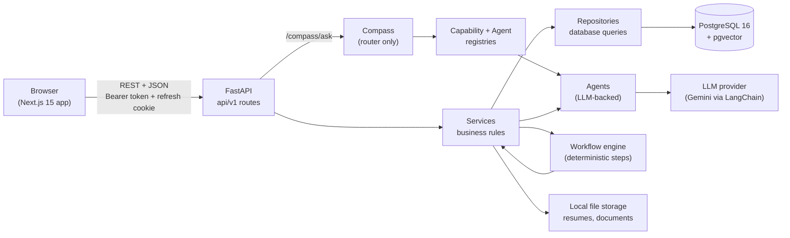
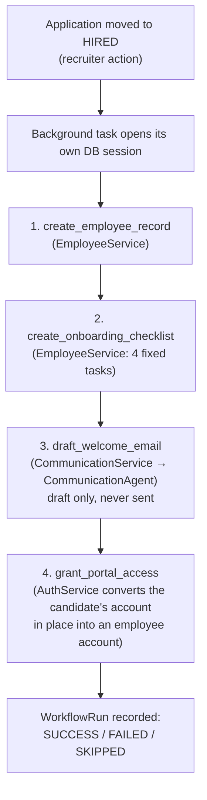

# 02 — Architecture

This document explains how Talign is built, why it is built that way, and which of those rules are checked by a machine rather than just promised in a comment. Everything here was read from the code in this repository; where the code differs from the original Product Book, the difference is stated openly in the last section.

If you only want the shape of it: a Next.js frontend talks to a FastAPI backend over a REST API; the backend is split into strict layers (API, services, repositories, models); the AI lives in separate "agents" that only a single router called **Compass** and a small deterministic **workflow engine** are allowed to call; and PostgreSQL (with the pgvector extension for similarity search) stores everything.

---

## 1. The system on one page

Reading the diagram from the left: a request enters through an API route, which does as little as possible (check who is calling, parse input, call a service, shape the output). The **service** owns the business rules. The **repository** is the only code that writes database queries. The AI sits to the side: services call agents when they need language-model reasoning, and Compass calls agents when a user asks it a question. Neither the API routes nor the repositories ever talk to a language model.

---

## 2. Backend layers and their rules

The backend lives in `backend/app/`. Each folder has one job and a rule about what it may and may not touch.

| Folder | Job | The rule that keeps it clean |
| --- | --- | --- |
| `api/v1/` | HTTP routes: authenticate, validate input, call one service, return a schema | No business logic, no database queries, no AI calls. Access rules are declared here as dependencies (`require_roles`). |
| `services/` | Business rules: what is allowed, in what order, in which company | The only layer that decides. Raises domain exceptions (never HTTP errors). Constructors accept optional injected repositories and agents so tests can replace them. |
| `repositories/` | Database queries, one file per entity | Contains no rule-checking. Services decide; repositories only fetch and store. |
| `models/` | SQLAlchemy table definitions | Describes data and its database-level constraints; contains no behaviour beyond small conveniences. |
| `schemas/` | Pydantic input/output shapes | The API's contract with the outside world. Candidate-facing schemas structurally cannot carry internal fields. |
| `agents/` | LLM-backed reasoning units with one job each | Receive plain data, never a database session or a service. Never talk to end users. |
| `compass/` | The single AI entry point for users | A pure router: it picks a capability and passes data along; it contains no business logic. |
| `workflow_engine/` | Runs fixed, multi-step business processes | Deterministic. Never calls an LLM, an agent, Compass or a service directly; each step is a callable handed in by the workflow. |
| `domain/` | Domain events ("a job was published") | A shared vocabulary, not an event bus. Nothing subscribes; events are logged. May not import from agents, Compass or the workflow engine. |
| `core/` | Cross-cutting infrastructure: config, security, exceptions, LLM provider, logging, rate limiter | The only place that reads environment variables, and the only place allowed to import an LLM SDK. |
| `utils/` | Small deterministic helpers: text extraction, chunking, file storage, slugs | No business rules, no AI. |

A word on **dependency injection**, since it explains the test strategy: every service constructor takes its repositories (and, where relevant, its agent) as optional arguments that default to the real ones. In production nothing is passed and the real ones are used; in a test, a fake is passed. That is how the whole backend suite (hundreds of tests) runs in about five seconds with no database and no API key.

### Rules checked by tests, not just by comments

Several of the boundaries above are enforced by tests that read the source code as a syntax tree (the "AST" tests), so a future edit that breaks a boundary fails the build even if no behaviour test would notice:

- `test_job_workflow_independence.py`, `test_application_workflow_independence.py`, `test_leave_request_workflow_independence.py` and `test_resume_intelligence_workflow_independence.py` prove that the Job, Application, Leave and Resume Intelligence modules never import the workflow engine.
- `test_workflow_engine_independence.py` proves the engine never imports Compass or an LLM provider.
- `test_candidate_analysis_exposure.py` proves that no route a candidate can reach is able to return analysis content (score, strengths, concerns).
- `test_config_safety.py` proves that a staging or production start refuses the default secret key and debug mode.

One rule is **stated but not enforced by a test**: "only `core/llm_provider.py` may import an LLM SDK." It is true today (the only file importing `langchain_google_genai` is that one), but nothing would fail if another file did it. It is a candidate for one more small AST test.

---

## 3. What happens during one request

The best way to see the layers cooperate is to follow a single, consequential action: a recruiter moves a candidate's application to **Hired**.

1. The browser calls `POST /api/v1/applications/{id}/transition` with the target status.
2. The route's dependency `require_roles(admin, recruiter)` rejects anyone else with 403.
3. `ApplicationService.transition_status` loads the application **scoped to the caller's company** (an application from another company simply does not exist as far as this caller is concerned: 404), checks the move is legal against the state machine, saves it, and logs a domain event.
4. Back in the route, if the new status is `hired`, the route schedules the hire workflow as a **background task** (FastAPI's mechanism for work that continues after the response has been sent), and re-reads the application for the response.
5. The recruiter gets their answer immediately. A moment later the background task opens its **own** database session (the request's session has already closed), builds the context it needs, and runs the four-step hire workflow (section 7). The outcome is recorded as a row in `workflow_runs`.

Two other actions follow the same pattern: attaching a resume to an application (or asking for re-analysis) schedules the resume analysis in the background, and uploading a knowledge document schedules its embedding in the background.

Background work uses FastAPI's built-in `BackgroundTasks`, which runs inside the web process. That is simple and right for one instance, with one consequence worth knowing: if the process is restarted at the wrong moment, an in-flight analysis is lost and has to be re-triggered (the recruiter can press re-analyze). A real job queue such as Celery or Temporal was named in the Product Book as the later step and was deliberately not built.

---

## 4. Errors and the middleware order

Services raise **domain exceptions** (`NotFoundError`, `ConflictError`, `DomainValidationError`, and so on, defined in `core/exceptions.py`) and never know that HTTP exists. One handler in `main.py` translates them into responses:

| Exception family | HTTP status |
| --- | --- |
| `DomainValidationError` and subclasses (invalid transition, job not open, unsupported file type, bad date range…) | 422 |
| `NotFoundError` (including "that resume is not yours") | 404 |
| `ConflictError` (duplicate email, duplicate application, email already sent, overlapping leave…) | 409 |
| `AuthenticationError` (bad credentials, invalid token, inactive account) | 401 |
| `AuthorizationError` | 403 |
| `TooManyLoginAttemptsError` | 429, with a `Retry-After` header |
| `LLMProviderError`, `InvalidStructuredOutputError`, `KnowledgeAnswerValidationError` | 502 (the AI provider failed or answered unusably) |
| `DocumentProcessingError` | 422 |
| Anything else unexpected | 500, with a generic JSON message |

A subtle point is the **order of the middleware**. A browser shows a response to the page only if it carries CORS headers, and an unhandled crash (a 500) used to be produced outside the CORS layer, so the browser reported "blocked by CORS policy" and hid the real error. The fix is `UnhandledExceptionMiddleware`, registered *before* `CORSMiddleware` so that it sits *inside* it: the crash becomes a JSON 500 that then travels outward through CORS and gets its headers. The full story is in `core/error_middleware.py` and is pinned by `test_unhandled_error_cors.py`. If you ever see a mysterious CORS error in development, check the backend logs for a crash first.

---

## 4a. Configuration

All configuration is read in one place, `core/config.py` (a Pydantic settings class), from environment variables or the `.env` file. Nothing else in the codebase reads the environment. The deployment document lists every variable; two behaviours matter architecturally:

- **Fail loudly in deployed environments.** With `ENVIRONMENT=staging` or `production`, the application refuses to start if the JWT secret is the default or shorter than 32 characters, or if `DEBUG` is on. It lists all problems at once.
- **Browser access is configuration, not code.** `CORS_ORIGINS` (a comma-separated list of exact origins; `*` is refused because the API uses cookies) and `COOKIE_SAMESITE` can be set per environment. `COOKIE_SAMESITE=none` requires HTTPS and is refused locally.

---

## 5. Authentication and sessions

Talign uses two tokens with different jobs:

- A short-lived **access token** (30 minutes by default), a signed JWT (JSON Web Token, a tamper-evident string carrying the user's id, company, account type and roles). The frontend keeps it **in memory only**, never in `localStorage`, so a script injected into the page cannot steal a long-lived credential from storage. It is sent as an `Authorization: Bearer` header.
- A long-lived **refresh token** (14 days), delivered only as an `httpOnly` cookie (invisible to JavaScript) restricted to the path `/api/v1/auth`. Its only use is to obtain a new access token.

The API's login response also sets a third, non-sensitive cookie, `talign_session`, a plain flag saying "this browser has signed in". It was used by an edge middleware to redirect signed-out visitors without a round trip. That middleware no longer exists (the frontend is now a static site, section 9), so nothing reads the flag; the backend still sets it, harmlessly. Route protection is done in the browser by the protected layout, and it was only ever a convenience: forging a cookie could never get past the server, because every API call is checked there.

On every request the server re-reads the user from the database rather than trusting the token's embedded roles (`api/deps.py`). That costs one query per request but means a disabled account stops working immediately instead of when its token expires.

**Failed-login throttling** (`core/login_rate_limiter.py`) counts wrong passwords per pair of (client address, email). After 5 wrong attempts in 15 minutes the pair is locked out, even for the correct password, and receives a 429 with `Retry-After`. It is in-memory and per process, which is correct for a single instance and would need a shared store (Redis) for several. The reasoning for keying by the pair rather than by address alone is in the module docstring: behind a misconfigured proxy, an address-only limit would lock out the whole site.

### Renewing the session, and a sleeping server

Two things the API client (`frontend/src/lib/api-client.ts`) does, both added for deployment and both covered by tests:

**Expired tokens are renewed silently.** When a normal request is answered `401` and the user had a token, the client calls the refresh endpoint once and retries the request with the new token. Requests that fail at the same moment share a single refresh. If the refresh fails, the session is over: the client tells `AuthProvider`, which drops the user so the protected layout sends them to sign in. A wrong password at sign-in is not mistaken for an expired token.

**A sleeping server is waited out, not mistaken for a failure.** The hosting tier used for the demo puts the API to sleep when idle, and waking it takes up to about a minute. A network error or a `502/503/504` marks the backend as *waking* (`lib/backend-status.ts`), which shows a "waking up the server" screen (`components/backend-wake-gate.tsx`) and starts polling the health endpoint. Requests that are safe to repeat (GETs, and the session refresh itself) then wait and retry once, so a signed-in visitor reloading a page against a sleeping API is **not** treated as signed out. Writes (`POST`, `PATCH`, `DELETE`) are never repeated automatically, because a repeated write could be applied twice. A `4xx` or `500` is never treated as waking: the server is awake and has answered.

---

## 6. Compass: one entry point, deliberately simple

Users never talk to an agent directly. They talk to **Compass**, through one endpoint, `POST /api/v1/compass/ask`, available to any signed-in user.

Compass does exactly five things and nothing else: work out what is being asked, build context by calling existing services, check the caller's role against the **capability registry**, select the capability by name, and route the request. Every actual decision has already been made elsewhere (by a service, or by the language model inside an agent) before Compass sees it.

How it decides what is being asked is intentionally *not* a language-model classification. It is a short, readable rule in `Compass._resolve_capability_for_role`:

| Caller's role | Workspace in view? | Capability |
| --- | --- | --- |
| Candidate | (any) | `application_status` |
| Employee | (any) | `knowledge_query` |
| Admin, Recruiter, Hiring manager | an application is open | `explain_analysis` |
| Admin, Recruiter, Hiring manager | no application open | `knowledge_query` |

The "workspace in view" signal is a structural fact the frontend already knows (is the user on a candidate's page?), so no guessing about the wording of the question is needed. The three capabilities are registered at startup in `compass/capabilities.py`, each with the set of roles allowed to use it, and the registry refuses to resolve a capability for a role that does not hold it. A candidate's Compass therefore *cannot* explain an alignment score regardless of how they phrase the question, because that capability is never registered for candidates.

`compass/intent.py` defines the shape for a future language-model intent classifier (the Product Book's "Intent Recognition" step), but nothing calls it today. It is scaffolding for the day a role has two capabilities that structure alone cannot tell apart.

---

## 7. Agents and the workflow engine

### Agents

An agent is a small, LLM-backed unit with one responsibility. The base contract is in `agents/base.py`: an agent receives an `AgentContext` (company id, user id, a plain-data payload) and returns an `AgentResult` (output plus a mandatory-by-convention `reasoning`). The five agents are:

| Agent | What it does | Who owns/calls it |
| --- | --- | --- |
| `ResumeIntelligenceAgent` | Extracts structure from a resume, reasons about alignment with a job, and explains an existing analysis | Resume analysis service; also registered for Compass's `explain_analysis` |
| `KnowledgeAgent` | Answers a question from retrieved company-document passages, with citations | `KnowledgeQueryService` |
| `CommunicationAgent` | Drafts rejection, interview-invitation and onboarding-welcome emails | `CommunicationService` |
| `DashboardAgent` | Writes the daily brief prose over already-computed facts | `DashboardService` |
| `ApplicationStatusAgent` | Tells a candidate the stage of their own application. Makes no model call: a templated sentence | Registered for Compass's `application_status` |

Only `ResumeIntelligenceAgent` and `ApplicationStatusAgent` sit in the **agent registry** that Compass looks up. The other three are deliberately *not* registered: each is a private collaborator of the service that owns it, because those services hold real business rules the bare agent does not know (for example, "a drafted email is not yet sent"). Letting anyone reach them through a registry would let that rule be bypassed. The AI System document (07) covers what each agent actually does and how its output is validated.

Every agent talks to a language model only through `LLMProvider` (`core/llm_provider.py`), by constructor injection. The Gemini implementation uses LangChain's `ChatGoogleGenerativeAI`; embeddings use `GoogleGenerativeAIEmbeddings`. Prompts live in dedicated `prompts.py` modules, each carrying a version string (for example `resume_extraction_v1`) that is stored alongside every result, so that when a prompt changes you can tell which results came from which version.

### The workflow engine

A **workflow** is a fixed sequence of deterministic steps. The engine (`workflow_engine/engine.py`) does one thing: it runs the steps in order, passes a running state dictionary along, and stops at the first step that raises, recording which steps had completed and which one failed. It has no retry logic and no knowledge of hiring, agents or services. The workflow is not a reasoning agent: it decides *which* steps run and *in what order*, never *how* an email is worded.

There is exactly one workflow today, `hire_candidate`, which runs when an application moves from Offer to Hired:

Every step is **idempotent**: running the workflow twice for the same application creates no duplicates, because each step first checks whether its work already exists (backed by a database `UNIQUE` constraint on `employees.application_id`). If every step reports it found its work already done, the run is recorded as `SKIPPED` rather than `SUCCESS`, so a duplicate trigger is visible instead of silent. Step 4 is the "one identity, two chapters" idea made concrete: the candidate's existing login (same email, same password) is flipped from a candidate account to an employee account of the hiring company. After that, the same person can no longer apply to other companies' jobs with that login. That is a documented MVP limitation, not an oversight.

### Domain events

`domain/events.py` defines events such as `JobPublished` and `ApplicationHired`. Services create them on state changes and **log** them; nothing subscribes. The vocabulary exists so that a real listener can be added later without changing the code that raises them. Calling it an event bus would overstate it, and the code comments are careful not to.

---

## 8. File storage

Uploaded resumes and knowledge documents are written to local disk (`LOCAL_STORAGE_PATH`, `./storage` by default; a Docker volume in Compose) by `utils/local_file_storage.py`, under `resumes/{candidate_id}/` and `knowledge/{company_id}/`. `STORAGE_PROVIDER` currently accepts only `local`. Local disk is fine on a developer machine and wrong for a host that wipes its disk on every deploy: that is covered in the deployment document.

---

## 9. Frontend architecture

The frontend (`frontend/`) is a Next.js 15 application using the App Router, React 18, TypeScript and Tailwind CSS. Data fetching and caching use TanStack React Query; forms use React Hook Form with Zod validation.

**Routes** live in `src/app/` in three route groups that decide the page shell: `(public)` for the careers pages anyone can open, `(auth)` for sign-in and the two registration flows, and `(protected)` for everything that needs a session. In total there are 18 pages (listed in the features document). The protected layout does two jobs for every page beneath it: it redirects to `/login` when there is no session, and it renders the shared navigation bar and the Compass panel provider.

**A static site.** In production the frontend is built as a **static export**: a folder of pre-built HTML, CSS and JavaScript (`npm run build` writes it to `frontend/out`) that any CDN can serve, with no Node server running. That is what lets the demo's web app load instantly even when the free-tier API behind it is asleep. It has three consequences worth knowing:

- *There is no middleware.* Next.js middleware needs a running server, so the old edge redirect was removed; the protected layout already redirected signed-out users in the browser.
- *Dynamic pages are built once.* A static site cannot know every candidate or job id in advance, so each of the five dynamic pages (`jobs/[id]`, `pipeline/[id]`, `applications/[id]`, `careers/[id]`, `careers/[id]/apply`) is built **once, for a placeholder id (`_`)**, and the host serves that same file for every real id (the rules are in `frontend/static-host-rules.json` and `render.yaml`). The page then reads the real id from the address bar through the `useRouteId` hook (`src/lib/route-id.ts`). Each such page is a small server file that declares the placeholder plus a `client.tsx` holding the actual page.
- *The API is reached through the same address.* The host forwards `/api/*` to the backend, so the browser only ever talks to one address, the sign-in cookie belongs to the site itself, and no CORS configuration is needed.

The static export is switched on only for production builds, so `npm run dev` (and therefore `docker compose`) still serves any id on demand. `npm run serve:export` serves a production build locally, applying the same rewrite rules and API forwarding as the host, so it can be tried without deploying.

**Features** live in `src/features/<name>/`, one folder per business area (applications, auth, communication, compass, dashboard, employees, jobs, knowledge, leave-requests, resumes). Each folder keeps its own `api.ts` (calls to the backend), `types.ts`, `hooks/` (React Query hooks) and `components/`, so everything about one area is found in one place. Pages in `src/app/` stay thin and compose feature components.

**The API client** (`src/lib/api-client.ts`) is the only code that calls `fetch`. It attaches the in-memory access token, sends cookies, turns non-2xx responses into a typed `ApiError` carrying the backend's `detail` message, handles empty (204) and unparseable bodies explicitly, and renews expired tokens and waits out a sleeping server (section 5).

**Navigation by role** is decided in `components/nav-bar.tsx` with three branches: candidates (Home, My applications, Browse jobs), plain employees (Dashboard, Knowledge, Leave), and the recruiting side (Dashboard, Jobs, Pipeline, Knowledge, plus "Leave requests" for admins and hiring managers). A subtle point, recorded in `lib/roles.ts`: `account_type === "internal"` is *not* enough to mean "recruiting staff", because a hired employee is also internal, so recruiter-only screens check roles rather than account type. These checks only decide what to *show*; the backend's role dependencies are the real security boundary.

**The design system** extends one visual identity from the landing page through the app. Colour tokens are defined in `tailwind.config.js` (`ink` for dark surfaces and text, `paper` for the page background, `accent` for the warm gold highlight, `line` for borders), the typeface is Inter loaded through `next/font`, and the building blocks are small hand-written primitives in `src/components/ui/`: `Button`, `Input`, `Card`, `Badge`, `Avatar` (initials only; the product has no photos), `Skeleton`, `EmptyState`, `Toast` and `AIMark` (a hand-drawn sparkle glyph used wherever Compass appears). The project does not use the shadcn/ui component library that the original brief named; the primitives are its own.

**The Compass panel** (`src/components/compass-panel/`) is a global ask-anything dialog opened with ⌘K / Ctrl+K from anywhere in the protected app. It adapts its scope to the user's role and the current page, the details of which are in the features document.

---

## 10. Where this differs from the Product Book and the original brief

The Product Book and `CLAUDE.md` described a larger vision and a slightly different stack. So that nobody has to discover this later, here is the honest list of differences between what was planned and what is built:

- **Agents.** The brief named four MVP agents including a "Workflow Agent" that coordinates the others. In the code, coordination is done by a deterministic workflow engine with no language model, plus two extra small agents (Dashboard, Application status). This was a deliberate decision: a fixed business process should be predictable, not reasoned about by a model.
- **Compass's intent detection** is a role-and-context rule, not a language-model classifier (section 6).
- **LangGraph** is declared as a dependency in `pyproject.toml` but is not imported anywhere in `app/`. Only LangChain's core and Google integration packages are used. The dependency is unused.
- **LLM provider.** The configuration accepts `openai` and `anthropic` as values, but only Gemini works: the OpenAI class is a placeholder that raises `NotImplementedError`, and `anthropic` is rejected by the factory. The abstraction is real; the second implementation is not.
- **shadcn/ui** is not used (section 9).
- **Background jobs** use FastAPI `BackgroundTasks`, not Celery or Temporal.
- **A dedicated vector database** was never needed: pgvector inside PostgreSQL holds the embeddings.
- **Features from the Product Book that are intentionally absent** (analytics, notifications, interview scheduling and kits, candidate comparison, real email sending, candidate rediscovery) are listed with their reasons in the roadmap document.
