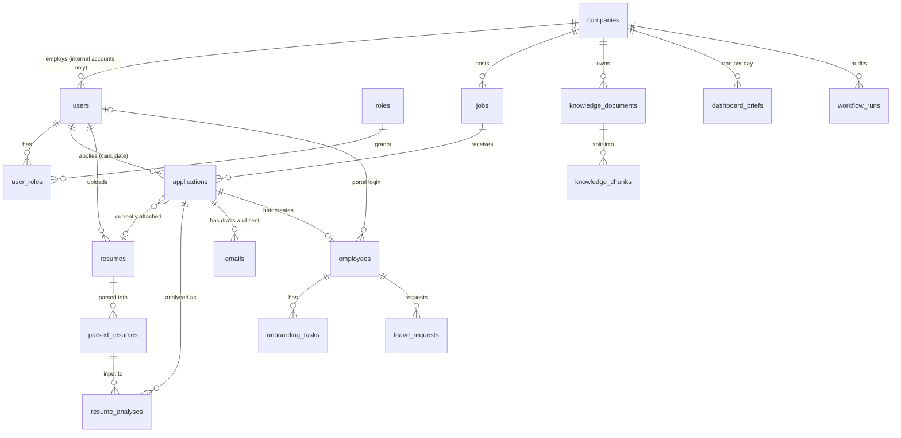
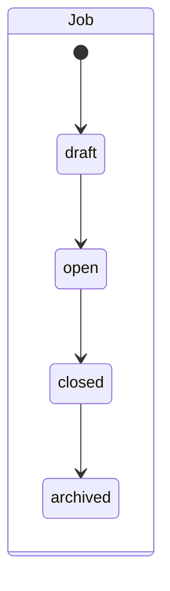
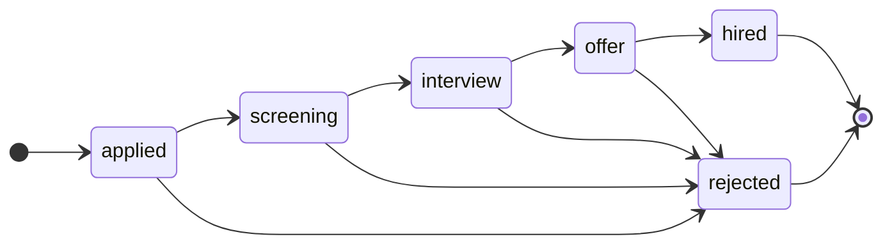
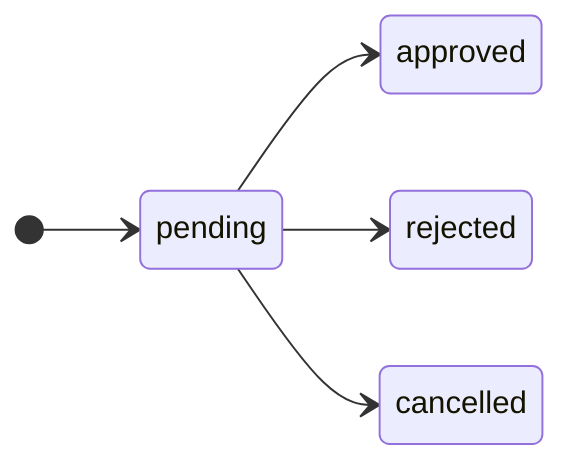
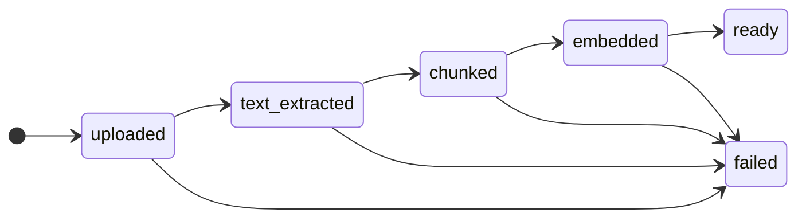

# 06 — Data model

This document describes everything Talign stores: what each table is for, how they relate, the rules the database itself enforces, how records move through their lifecycles, and the migration history. The column-by-column reference in section 6 is **generated from the SQLAlchemy models** and checked by a test, so it cannot silently go out of date; the explanations around it are written by hand.

The database is PostgreSQL 16 with the **pgvector** extension (which adds a vector column type and similarity operators, used to search company documents by meaning). There are 17 tables, built by 10 Alembic migrations (Alembic is the tool that applies versioned changes to the database structure).

---

## 1. The shape of the data

Read it as a story. A **company** posts **jobs**. A **candidate** (a user without a company) uploads **resumes** and creates **applications** to jobs. Each application is analysed against its job, producing **resume analyses**, and can accumulate **emails**. When an application ends in a hire, an **employee** record appears, with an **onboarding checklist**, and the candidate's user account is converted into an employee account; that employee can then file **leave requests**. Separately, a company owns **knowledge documents**, which are split into **chunks** for search; the dashboard caches one **brief** per company per day; and every automated hire is audited in **workflow runs**.

---

## 2. Design decisions that explain the shape

**One `users` table for every human.** There is no separate table for recruiters, employees or candidates. What someone *is allowed to do* comes from the `roles` and `user_roles` tables; the `account_type` column (`internal` or `candidate`) exists so that one database constraint can enforce "internal accounts must have a company, candidate accounts must not" without joining other tables. `roles` is a lookup table filled by a migration (the five rows `admin`, `recruiter`, `hiring_manager`, `employee`, `candidate`), not a database enum, so adding a role is a data insert rather than a schema change.

**A candidate is a user, and hiring converts that same row.** Because the candidate is already a `users` row, hiring someone does not create a second identity: the workflow flips three things on the existing row (account type, company, role). This is why `employees.user_id` can be linked back to the very user who applied.

**Application state lives on the application, never on the candidate or the job.** One candidate can apply to many jobs, across companies, and each application has its own stage, resume, analyses and emails. The pair `(candidate_id, job_id)` is unique, so applying twice is impossible, and the check is made in both the service (for a friendly message) and the database (so nothing can bypass it).

**AI results are never overwritten.** A resume is *parsed* once into `parsed_resumes`, then *analysed* against each job into `resume_analyses`. Re-analysing inserts a new row; nothing changes after an analysis leaves `pending`. Each of these rows records the provider, model and prompt version that produced it. The practical benefit is that you can always answer "which prompt produced this score?", compare an old result with a new one, and avoid paying for a second parse of a resume that has not changed. The numeric score is computed by Talign's own code from the model's structured judgements; the language model never produces the final score directly (see the AI system document).

**`company_id` is copied onto child tables on purpose.** Applications, emails, knowledge chunks, leave requests and workflow runs each store `company_id` even though it could be found through a parent. The copy is set once at creation and never changes. It makes the "only my company's data" filter a direct column comparison, which matters most for the knowledge-chunk table, whose vector search runs on every Compass policy question and filters by company first.

**Rules are enforced twice.** Each lifecycle and invariant that matters has a database `CHECK` or `UNIQUE` constraint *and* a service-layer check. The database constraint says which values are valid; the service holds the rules about which *transitions* are legal. A rule that spans other rows (a leave request may not overlap another; a candidate id must belong to a candidate account) cannot be a plain `CHECK`, so it lives only in the service, as the model docstrings say.

---

## 3. The tables, by area

### Identity and company

- **`companies`** — an organisation using Talign: name, a unique URL-safe `slug`, optional industry, size and country, and a timezone (default `UTC`).
- **`users`** — one row per person. Email is globally unique (so one email is one identity on the whole platform). Holds a bcrypt password hash, names, a status (`active`, `invited`, `disabled`; only `active` can sign in; `invited` is reserved for a future email-invite flow), and last-login time. `company_id` is required for internal accounts and forbidden for candidates.
- **`roles`** and **`user_roles`** — the role lookup and the many-to-many link between users and roles (unique per pair).

### Recruitment

- **`jobs`** — a vacancy: title, description, employment type, location, an optional salary range with a currency *label* (no conversion anywhere), and a status. It also carries three **recruiter-authored scoring criteria**: `required_skills`, `preferred_skills` and `min_years_experience`. These three fields, and only these, are what the analysis scores against; the free-text description is context and is never silently turned into criteria.
- **`applications`** — the link between a candidate and a job, with the pipeline `status`, the currently attached `resume_id` (nullable: an application can exist before any resume is attached), and the copied `company_id`.
- **`resumes`** — a file a candidate uploaded (path, original name, content type, size), plus `raw_text`, filled by a deterministic extraction step (no AI) from PDF, DOCX or plain text. A resume belongs to the candidate, not to one application, and can be attached to many.
- **`parsed_resumes`** — the first AI step's output: skills, experience entries, total years, education and certifications as structured data, with provenance (provider, model, prompt version) and a status (`completed` or `failed`).
- **`resume_analyses`** — the second step's output for one application: the three sub-scores and the overall score, the per-skill match results (each *matched*, *not matched* or *insufficient evidence*), matched and missing skills, strengths, potential concerns, a written explanation, the scoring algorithm version, and provenance. Its status is `pending`, `completed` or `failed`.
- **`emails`** — a drafted or sent email tied to an application: type (`rejection`, `interview_invitation`, `onboarding_welcome`), status (`draft` or `sent`), the recipient copied at creation time, subject, body, and provenance. Talign never actually sends email: "sent" means the recruiter has sent it through their own tooling and is recording that fact. A sent email is immutable.

### Employees

- **`employees`** — created by the hire workflow: name, email, job title and hire date copied from the application, `status` (only `active` exists), and an optional link to the user. `application_id` is **unique**, which is the database half of the hire workflow's idempotency guarantee.
- **`onboarding_tasks`** — a flat checklist per employee (title and a completed flag). The hire workflow creates four fixed tasks: "Set up workstation", "IT account provisioning", "Manager intro meeting" and "Complete new-hire paperwork". There is no endpoint that ticks them off yet, so in this version the checklist is created and displayed but not completed.
- **`leave_requests`** — an employee's leave request: dates, type (`vacation`, `sick`, `personal`), optional reason, status, and who reviewed it and when. A database check requires `end_date >= start_date`.

### Knowledge

- **`knowledge_documents`** — an uploaded company document: title, category (`policy`, `benefits`, `procedure`, `other`), file details, a processing status, an error message if processing failed, and **embedding provenance** (model, dimension, version, last-processed time) so that if the embedding model or chunking strategy changes, you can find which documents were indexed with the old one.
- **`knowledge_chunks`** — the pieces of each document that are actually searched: `chunk_index`, `content`, `token_count`, and an `embedding` vector of **768 dimensions** (the `gemini-embedding-001` output, shortened from its native 3072). The vector column is nullable because chunks are inserted when a document is split and filled in later, when embedding finishes.

### Automation and audit

- **`dashboard_briefs`** — the AI-written daily brief, cached once per company per calendar day (UTC) so refreshing the dashboard never changes the text or costs another model call. Unique on `(company_id, brief_date)`. Everything else on the dashboard (counts, funnel, attention items) is recomputed from the database on every request and never cached or AI-generated.
- **`workflow_runs`** — a write-once audit row for each hire-workflow attempt: the workflow name, what triggered it, the outcome (`success`, `failed`, `skipped`), which steps completed, and which one failed with what error. It is a log, not a queue: nothing replays from it.

---

## 4. Lifecycles

Every status column is backed by a database `CHECK` listing the valid values; the diagrams show the *transitions*, which only the service layer enforces.

A **job** moves strictly forward: `draft → open → closed → archived`, with no skipping and no going back. Only `draft` jobs can be deleted; anything published is closed and archived instead. Only `open` jobs appear on the public board and accept applications.

An **application** moves one step forward at a time, or can be rejected from any stage before the end. `hired` and `rejected` are terminal. Moving to `hired` triggers the hire workflow.

A **leave request** starts `pending` and ends in exactly one terminal state: approved or rejected by an admin or hiring manager, or cancelled by the employee who made it. A new request may not overlap an existing `pending` or `approved` request of the same employee; cancelled and rejected ones never block.

A **knowledge document** goes through a pipeline. The first three steps (store the file, extract text, split into chunks) happen inside the upload request because they involve no network calls; the last two (embed, mark ready) run in a background task because embedding calls Google's API. `failed` is reachable from any step before `ready`. An admin can **re-index** a document, which resets it and runs the pipeline again from the start; this is modelled as a reset, not as a backward transition.

The remaining status columns are simpler. A **resume** is `uploaded`, then `text_ready` or `parse_failed`. A **parsed resume** is `completed` or `failed`. A **resume analysis** is `pending`, then `completed` or `failed`. An **email** is `draft`, then `sent` (permanent). A **workflow run** is recorded as `success`, `failed` or `skipped`.

The progress label the frontend polls while an analysis runs (`not_started`, `parsing`, `analyzing`, `complete`, `failed`) is **not stored**; it is derived on demand from the resume, parsed resume and analysis rows together.

---

## 5. Indexes, and a note on where they are defined

Most indexes exist only in the migrations, not in the model classes, so the migrations are the authority. A direct comparison of the migrated database against the models (Alembic's autogenerate diff, run against a freshly migrated PostgreSQL) reports 25 differences, all of them indexes plus the way single-column uniqueness on `users.email` and `companies.slug` is declared; there is no difference in any column or check constraint. The indexes in the migrated database, read from PostgreSQL itself:

| Table | Index | Columns |
| --- | --- | --- |
| `applications` | `ix_applications_candidate_id`, `ix_applications_job_id`, `ix_applications_company_id` | one column each |
| `applications` | `ix_applications_company_status` | `company_id`, `status` (the pipeline and dashboard funnel) |
| `emails` | `ix_emails_application_id`, `ix_emails_company_id` | one column each |
| `emails` | `ix_emails_application_type_status` | `application_id`, `email_type`, `status` |
| `jobs` | `ix_jobs_company_id`, `ix_jobs_status` | one column each |
| `knowledge_chunks` | `ix_knowledge_chunks_company_document` | `company_id`, `document_id` |
| `leave_requests` | `ix_leave_requests_company_id_status` | `company_id`, `status` |
| `leave_requests` | `ix_leave_requests_employee_id` | `employee_id` |
| `onboarding_tasks` | `ix_onboarding_tasks_employee_id` | `employee_id` |
| `parsed_resumes` | `ix_parsed_resumes_resume_id`, `ix_parsed_resumes_resume_status` | `resume_id`; `resume_id`, `status` |
| `resume_analyses` | `ix_resume_analyses_application_id`, `ix_resume_analyses_application_status` | `application_id`; `application_id`, `status` |
| `resumes` | `ix_resumes_candidate_id` | `candidate_id` |
| `workflow_runs` | `ix_workflow_runs_trigger` | `trigger_entity_type`, `trigger_entity_id` |
| `dashboard_briefs` | `ix_dashboard_briefs_company_date` | `company_id`, `brief_date` (duplicates the unique constraint) |
| `users` / `companies` | `ix_users_email` / `ix_companies_slug` | a plain index next to the unique constraint on the same column (redundant but harmless) |

There is **no vector index** (no approximate-nearest-neighbour index such as HNSW or IVFFlat) on `knowledge_chunks.embedding`. Retrieval filters by company and then ranks by cosine distance, which is an exact scan of one company's chunks. At the data volumes this project targets that is fast enough, and an approximate index would only be justified by far more documents.

---

## 6. Data dictionary (generated)

Generated from the models by `backend/scripts/schema_doc.py` and checked by `backend/tests/test_docs_match_code.py`. To refresh after a model change, run `python scripts/schema_doc.py` from `backend/` and replace the text between the markers. Types are PostgreSQL types; "Required" means `NOT NULL`; "default: database clock" means the database fills the value with the current time.

<!-- BEGIN GENERATED: data-dictionary -->

### `applications`

| Column | Type | Required | Notes |
| --- | --- | :---: | --- |
| `id` | uuid | yes | primary key |
| `candidate_id` | uuid | yes | → `users.id`, on delete cascade |
| `job_id` | uuid | yes | → `jobs.id`, on delete cascade |
| `company_id` | uuid | yes | → `companies.id`, on delete cascade |
| `resume_id` | uuid |  | → `resumes.id`, on delete set null |
| `status` | varchar(20) | yes | default: `applied` |
| `created_at` | timestamp with time zone | yes | default: database clock |
| `updated_at` | timestamp with time zone | yes | default: database clock |

Constraints:

- `ck_applications_status_valid` (check): `status IN ('applied', 'screening', 'interview', 'offer', 'hired', 'rejected')`
- `uq_applications_candidate_job` (unique): `candidate_id, job_id`

### `companies`

| Column | Type | Required | Notes |
| --- | --- | :---: | --- |
| `id` | uuid | yes | primary key |
| `name` | varchar(255) | yes |  |
| `slug` | varchar(255) | yes | unique |
| `logo_url` | varchar(512) |  |  |
| `industry` | varchar(255) |  |  |
| `size` | varchar(50) |  |  |
| `country` | varchar(100) |  |  |
| `timezone` | varchar(64) | yes | default: `UTC` |
| `created_at` | timestamp with time zone | yes | default: database clock |
| `updated_at` | timestamp with time zone | yes | default: database clock |

### `dashboard_briefs`

| Column | Type | Required | Notes |
| --- | --- | :---: | --- |
| `id` | uuid | yes | primary key |
| `company_id` | uuid | yes | → `companies.id`, on delete cascade |
| `brief_date` | date | yes |  |
| `summary` | text | yes |  |
| `recommended_actions` | json | yes |  |
| `llm_provider` | varchar(50) |  |  |
| `llm_model` | varchar(100) |  |  |
| `prompt_version` | varchar(50) |  |  |
| `created_at` | timestamp with time zone | yes | default: database clock |

Constraints:

- `uq_dashboard_briefs_company_date` (unique): `company_id, brief_date`

### `emails`

| Column | Type | Required | Notes |
| --- | --- | :---: | --- |
| `id` | uuid | yes | primary key |
| `application_id` | uuid | yes | → `applications.id`, on delete cascade |
| `company_id` | uuid | yes | → `companies.id`, on delete cascade |
| `created_by` | uuid |  | → `users.id`, on delete set null |
| `email_type` | varchar(30) | yes |  |
| `status` | varchar(10) | yes | default: `draft` |
| `recipient_email` | varchar(255) | yes |  |
| `subject` | varchar(255) | yes |  |
| `body` | text | yes |  |
| `llm_provider` | varchar(50) |  |  |
| `llm_model` | varchar(100) |  |  |
| `prompt_version` | varchar(50) |  |  |
| `sent_at` | timestamp with time zone |  |  |
| `created_at` | timestamp with time zone | yes | default: database clock |
| `updated_at` | timestamp with time zone | yes | default: database clock |

Constraints:

- `ck_emails_status_valid` (check): `status IN ('draft', 'sent')`
- `ck_emails_type_valid` (check): `email_type IN ('rejection', 'interview_invitation', 'onboarding_welcome')`

### `employees`

| Column | Type | Required | Notes |
| --- | --- | :---: | --- |
| `id` | uuid | yes | primary key |
| `company_id` | uuid | yes | → `companies.id`, on delete cascade |
| `application_id` | uuid | yes | → `applications.id`, on delete cascade; unique |
| `user_id` | uuid |  | → `users.id`, on delete set null |
| `first_name` | varchar(100) | yes |  |
| `last_name` | varchar(100) | yes |  |
| `email` | varchar(255) | yes |  |
| `job_title` | varchar(255) | yes |  |
| `hire_date` | date | yes |  |
| `status` | varchar(20) | yes | default: `active` |
| `created_at` | timestamp with time zone | yes | default: database clock |
| `updated_at` | timestamp with time zone | yes | default: database clock |

Constraints:

- `ck_employees_status_valid` (check): `status IN ('active')`

### `jobs`

| Column | Type | Required | Notes |
| --- | --- | :---: | --- |
| `id` | uuid | yes | primary key |
| `company_id` | uuid | yes | → `companies.id`, on delete cascade |
| `created_by` | uuid |  | → `users.id`, on delete set null |
| `title` | varchar(255) | yes |  |
| `description` | text | yes |  |
| `employment_type` | varchar(20) | yes |  |
| `location` | varchar(255) |  |  |
| `salary_min` | integer |  |  |
| `salary_max` | integer |  |  |
| `salary_currency` | varchar(3) | yes | default: `USD` |
| `status` | varchar(20) | yes | default: `draft` |
| `required_skills` | jsonb | yes |  |
| `preferred_skills` | jsonb | yes |  |
| `min_years_experience` | integer |  |  |
| `created_at` | timestamp with time zone | yes | default: database clock |
| `updated_at` | timestamp with time zone | yes | default: database clock |

Constraints:

- `ck_jobs_employment_type_valid` (check): `employment_type IN ('full_time', 'part_time', 'contract', 'internship')`
- `ck_jobs_salary_currency_valid` (check): `salary_currency IN ('USD', 'EUR', 'GBP', 'CAD')`
- `ck_jobs_salary_range_valid` (check): `salary_min IS NULL OR salary_max IS NULL OR salary_min <= salary_max`
- `ck_jobs_status_valid` (check): `status IN ('draft', 'open', 'closed', 'archived')`

### `knowledge_chunks`

| Column | Type | Required | Notes |
| --- | --- | :---: | --- |
| `id` | uuid | yes | primary key |
| `document_id` | uuid | yes | → `knowledge_documents.id`, on delete cascade |
| `company_id` | uuid | yes | → `companies.id`, on delete cascade |
| `chunk_index` | integer | yes |  |
| `content` | text | yes |  |
| `token_count` | integer | yes |  |
| `embedding` | vector(768) |  |  |
| `created_at` | timestamp with time zone | yes | default: database clock |

### `knowledge_documents`

| Column | Type | Required | Notes |
| --- | --- | :---: | --- |
| `id` | uuid | yes | primary key |
| `company_id` | uuid | yes | → `companies.id`, on delete cascade |
| `uploaded_by` | uuid |  | → `users.id`, on delete set null |
| `title` | varchar(255) | yes |  |
| `category` | varchar(30) | yes | default: `other` |
| `file_path` | varchar(1024) | yes |  |
| `original_filename` | varchar(255) | yes |  |
| `content_type` | varchar(100) | yes |  |
| `file_size_bytes` | integer | yes |  |
| `status` | varchar(20) | yes | default: `uploaded` |
| `error_message` | text |  |  |
| `embedding_model` | varchar(100) |  |  |
| `embedding_dimension` | integer |  |  |
| `embedding_version` | varchar(50) |  |  |
| `last_processed_at` | timestamp with time zone |  |  |
| `created_at` | timestamp with time zone | yes | default: database clock |
| `updated_at` | timestamp with time zone | yes | default: database clock |

Constraints:

- `ck_knowledge_documents_category_valid` (check): `category IN ('policy', 'benefits', 'procedure', 'other')`
- `ck_knowledge_documents_status_valid` (check): `status IN ('uploaded', 'text_extracted', 'chunked', 'embedded', 'ready', 'failed')`

### `leave_requests`

| Column | Type | Required | Notes |
| --- | --- | :---: | --- |
| `id` | uuid | yes | primary key |
| `employee_id` | uuid | yes | → `employees.id`, on delete cascade |
| `company_id` | uuid | yes | → `companies.id`, on delete cascade |
| `start_date` | date | yes |  |
| `end_date` | date | yes |  |
| `leave_type` | varchar(20) | yes |  |
| `reason` | text |  |  |
| `status` | varchar(20) | yes | default: `pending` |
| `reviewed_by` | uuid |  | → `users.id`, on delete set null |
| `reviewed_at` | timestamp with time zone |  |  |
| `created_at` | timestamp with time zone | yes | default: database clock |
| `updated_at` | timestamp with time zone | yes | default: database clock |

Constraints:

- `ck_leave_requests_date_range_valid` (check): `end_date >= start_date`
- `ck_leave_requests_leave_type_valid` (check): `leave_type IN ('vacation', 'sick', 'personal')`
- `ck_leave_requests_status_valid` (check): `status IN ('pending', 'approved', 'rejected', 'cancelled')`

### `onboarding_tasks`

| Column | Type | Required | Notes |
| --- | --- | :---: | --- |
| `id` | uuid | yes | primary key |
| `employee_id` | uuid | yes | → `employees.id`, on delete cascade |
| `title` | varchar(255) | yes |  |
| `completed` | boolean | yes | default: `False` |
| `created_at` | timestamp with time zone | yes | default: database clock |

### `parsed_resumes`

| Column | Type | Required | Notes |
| --- | --- | :---: | --- |
| `id` | uuid | yes | primary key |
| `resume_id` | uuid | yes | → `resumes.id`, on delete cascade |
| `extracted_skills` | jsonb | yes |  |
| `experience_entries` | jsonb | yes |  |
| `total_years_experience` | float |  |  |
| `education` | jsonb | yes |  |
| `certifications` | jsonb | yes |  |
| `llm_provider` | varchar(50) | yes |  |
| `llm_model` | varchar(100) | yes |  |
| `prompt_version` | varchar(50) | yes |  |
| `status` | varchar(20) | yes |  |
| `error_message` | text |  |  |
| `created_at` | timestamp with time zone | yes | default: database clock |

### `resume_analyses`

| Column | Type | Required | Notes |
| --- | --- | :---: | --- |
| `id` | uuid | yes | primary key |
| `application_id` | uuid | yes | → `applications.id`, on delete cascade |
| `parsed_resume_id` | uuid | yes | → `parsed_resumes.id`, on delete cascade |
| `status` | varchar(20) | yes | default: `pending` |
| `overall_score` | float |  |  |
| `required_skills_score_pct` | float |  |  |
| `preferred_skills_score_pct` | float |  |  |
| `experience_score_pct` | float |  |  |
| `scoring_algorithm_version` | varchar(50) |  |  |
| `required_skills_result` | jsonb | yes |  |
| `preferred_skills_result` | jsonb | yes |  |
| `experience_fit` | jsonb |  |  |
| `matched_skills` | jsonb | yes |  |
| `missing_skills` | jsonb | yes |  |
| `strengths` | jsonb | yes |  |
| `potential_concerns` | jsonb | yes |  |
| `explanation` | text |  |  |
| `llm_provider` | varchar(50) |  |  |
| `llm_model` | varchar(100) |  |  |
| `prompt_version` | varchar(50) |  |  |
| `error_message` | text |  |  |
| `analyzed_at` | timestamp with time zone |  |  |
| `created_at` | timestamp with time zone | yes | default: database clock |
| `updated_at` | timestamp with time zone | yes | default: database clock |

Constraints:

- `ck_resume_analyses_status_valid` (check): `status IN ('pending', 'completed', 'failed')`

### `resumes`

| Column | Type | Required | Notes |
| --- | --- | :---: | --- |
| `id` | uuid | yes | primary key |
| `candidate_id` | uuid | yes | → `users.id`, on delete cascade |
| `file_path` | varchar(1024) | yes |  |
| `original_filename` | varchar(255) | yes |  |
| `content_type` | varchar(100) | yes |  |
| `file_size_bytes` | integer | yes |  |
| `raw_text` | text |  |  |
| `status` | varchar(20) | yes | default: `uploaded` |
| `parse_error` | text |  |  |
| `created_at` | timestamp with time zone | yes | default: database clock |
| `updated_at` | timestamp with time zone | yes | default: database clock |

### `roles`

| Column | Type | Required | Notes |
| --- | --- | :---: | --- |
| `id` | uuid | yes | primary key |
| `name` | varchar(50) | yes | unique |
| `description` | varchar(255) |  |  |

### `user_roles`

| Column | Type | Required | Notes |
| --- | --- | :---: | --- |
| `id` | uuid | yes | primary key |
| `user_id` | uuid | yes | → `users.id`, on delete cascade |
| `role_id` | uuid | yes | → `roles.id`, on delete cascade |
| `created_at` | timestamp with time zone | yes | default: database clock |

Constraints:

- `uq_user_roles_user_role` (unique): `user_id, role_id`

### `users`

| Column | Type | Required | Notes |
| --- | --- | :---: | --- |
| `id` | uuid | yes | primary key |
| `company_id` | uuid |  | → `companies.id`, on delete cascade |
| `account_type` | varchar(20) | yes |  |
| `email` | varchar(255) | yes | unique |
| `password_hash` | varchar(255) | yes |  |
| `first_name` | varchar(100) | yes |  |
| `last_name` | varchar(100) | yes |  |
| `avatar_url` | varchar(512) |  |  |
| `status` | varchar(20) | yes | default: `active` |
| `last_login_at` | timestamp with time zone |  |  |
| `created_at` | timestamp with time zone | yes | default: database clock |
| `updated_at` | timestamp with time zone | yes | default: database clock |

Constraints:

- `ck_users_company_assignment` (check): `(account_type = 'candidate' AND company_id IS NULL) OR (account_type = 'internal' AND company_id IS NOT NULL)`

### `workflow_runs`

| Column | Type | Required | Notes |
| --- | --- | :---: | --- |
| `id` | uuid | yes | primary key |
| `company_id` | uuid | yes | → `companies.id`, on delete cascade |
| `workflow_name` | varchar(100) | yes |  |
| `trigger_entity_type` | varchar(50) | yes |  |
| `trigger_entity_id` | uuid | yes |  |
| `status` | varchar(20) | yes |  |
| `completed_steps` | json | yes |  |
| `failed_step` | varchar(100) |  |  |
| `error` | text |  |  |
| `created_at` | timestamp with time zone | yes | default: database clock |

<!-- END GENERATED: data-dictionary -->

---

## 7. Migration history

The migrations form one straight chain (no branches). Apply them with `alembic upgrade head`; in Docker Compose that is `docker compose exec backend alembic upgrade head` the first time (and after pulling changes that add a migration).

| Order | Revision | Date | What it adds |
| :---: | --- | --- | --- |
| 1 | `a9bb0d24163b` | 2026-07-18 | Identity: `companies`, `roles` (seeded with the five roles), `users`, `user_roles` |
| 2 | `80dcdaf48a88` | 2026-07-18 | `jobs` |
| 3 | `4aa8bf6c4be0` | 2026-07-18 | `applications` |
| 4 | `a78ee5b3422c` | 2026-07-19 | Resume intelligence: `resumes`, `parsed_resumes`, `resume_analyses`; the job scoring-criteria columns; `applications.resume_id` |
| 5 | `b1c2d3e4f5a6` | 2026-07-26 | `jobs.salary_currency` with its check |
| 6 | `c2d3e4f5a6b7` | 2026-07-27 | `emails` |
| 7 | `d3e4f5a6b7c8` | 2026-08-19 | The `vector` extension; `knowledge_documents`, `knowledge_chunks` |
| 8 | `e4f5a6b7c8d9` | 2026-08-20 | Workflow engine: `employees`, `onboarding_tasks`, `workflow_runs`; adds `onboarding_welcome` to the email-type check |
| 9 | `f5a6b7c8d9e0` | 2026-08-24 | `dashboard_briefs` |
| 10 | `a1b2c3d4e5f6` | 2026-09-19 | `leave_requests` |

All ten migrations were applied to a fresh PostgreSQL with pgvector while writing this document and completed without error.
