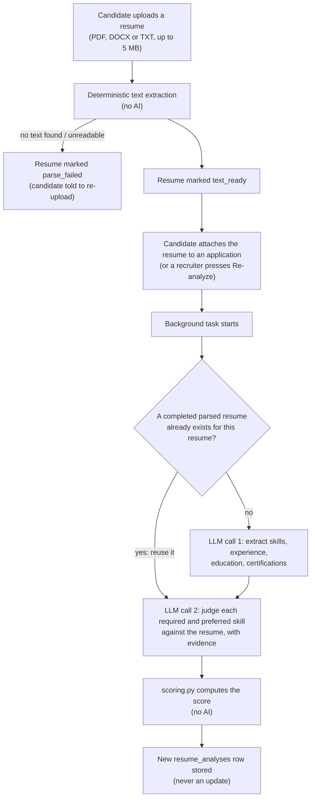
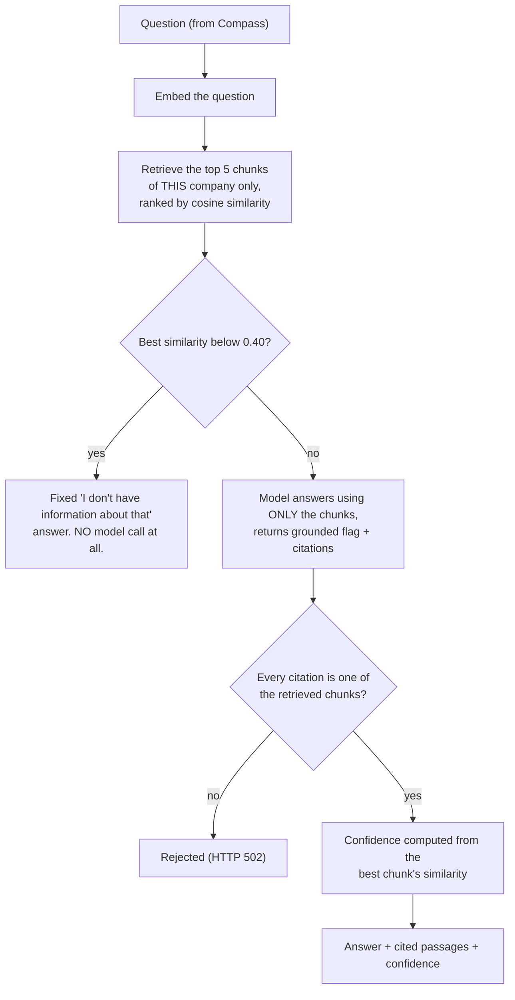

# 07 — The AI system

This document explains every place Talign uses a language model, what it is and is not allowed to do there, how its output is checked, and how reproducible and explainable each result is. It was written from the code (the agent, prompt, scoring and service modules named in each section), and says plainly where something has **not** been verified.

The short version: Talign uses AI to *read, summarise and draft*, never to *decide or count*. A language model never produces a score, a confidence level, a count or a status change. Those numbers come from small, deterministic functions that you can read and test without any model. Every AI result is stored with the model and prompt version that produced it, every answer that claims to come from a document must point at a real passage, and every consequential action (hire, reject, send an email) is a human click.

---

## 1. Principles, and how each is enforced

| Principle | How it is enforced in the code |
| --- | --- |
| **AI assists, humans decide** | No agent can move an application, hire, reject or send. Stage changes are routes that only `admin`/`recruiter` can call. The hire workflow runs only *after* a human moves an application to Hired, and it only *drafts* the welcome email. "Sent" is a manual recording by a human. |
| **The model never produces a number** | The alignment schema has no score field. `scoring.py` computes the score from the model's per-skill judgements. Knowledge confidence is computed from retrieval similarity (`confidence.py`), not asked of the model. Dashboard counts and funnels are SQL. |
| **Explain everything** | Every skill judgement carries evidence from the resume; the analysis stores strengths, concerns and a written explanation; knowledge answers cite the exact passages; Compass's `explain_analysis` narrates the stored analysis without adding judgements. |
| **No fabricated sources** | A knowledge answer's citations are checked against the set of passages actually retrieved; one that cites anything else is rejected outright. The dashboard brief's suggested actions have unknown application ids stripped. |
| **Nothing is lost or overwritten** | Parsed resumes and analyses are append-only, each stamped with provider, model and prompt version (and, for analyses, the scoring-algorithm version). |
| **Fail visibly, not silently** | A failed analysis is stored as a `failed` row with its error. A failed dashboard brief shows nothing and the rest of the dashboard still loads. A failed AI call surfaces as HTTP 502. |
| **One boundary to the AI vendor** | Only `core/llm_provider.py` imports an LLM library. Everything else depends on the `LLMProvider` and `EmbeddingProvider` interfaces. |

---

## 2. The plumbing

### The provider interface

`core/llm_provider.py` defines two interfaces. `LLMProvider` has `complete` (free text) and `complete_structured` (the answer must validate against a Pydantic schema). `EmbeddingProvider` turns text into vectors, with separate methods for *documents being indexed* and *queries being asked*, because Gemini's embedding model is asymmetric (it produces measurably better retrieval when it knows which kind of text it is embedding).

The working implementation is `GeminiProvider`, built on LangChain's `ChatGoogleGenerativeAI`, and `GeminiEmbeddingProvider`. The default chat model is `gemini-2.5-flash` (the `LLM_DEFAULT_MODEL` setting); embeddings use `gemini-embedding-001`, shortened from its native 3072 dimensions to **768** (the model supports truncation by design, and 768 keeps the database column small). An OpenAI class exists only as a placeholder that raises `NotImplementedError`; the factory refuses `anthropic`. In practice Gemini is the only provider, and `GOOGLE_API_KEY` is required for any AI feature.

Temperatures are set by purpose: structured extraction and judgement calls run at **0.0** (as deterministic as the model allows), free-text calls default to 0.2, and the Compass explanation uses 0.3.

### Two kinds of failure, deliberately kept apart

`complete_structured` raises `InvalidStructuredOutputError` when the model answered but the answer did not match the schema, and `LLMProviderError` for anything else (network, timeout, rate limit, bad key). The distinction drives behaviour: the shared helper `agents/shared/structured_output.py` (and an equivalent method on the Resume Intelligence agent) **retries exactly once**, with a message asking the model to answer again strictly in the schema, but only for the first kind. A provider failure is never retried automatically. Anything that still fails becomes a clear stored or returned error; nothing retries in the background by itself, so a recruiter must press re-analyze to try again.

### Versioned prompts

Prompts are not inline strings scattered through services. Each agent has a `prompts.py` with builder functions and a version constant, and the version is saved with every result:

| Prompt | Version string |
| --- | --- |
| Resume extraction | `resume_extraction_v1` |
| Alignment reasoning | `alignment_analysis_v1` |
| Knowledge answer | `knowledge_answer_v1` |
| Rejection email | `rejection_email_v1` |
| Interview invitation email | `interview_invitation_email_v1` |
| Onboarding welcome email | `onboarding_welcome_email_v1` |
| Daily brief | `daily_brief_v1` |

Two further versions are not prompts but algorithms: `weighted_v1` (scoring) and `similarity_bands_v1` (retrieval confidence), plus `recursive_v1` for document chunking. Whenever one of these changes, its version is bumped so an old result can always be traced to the exact rules that produced it.

The Product Book imagined prompts stored in a database table so they could be edited without a deploy. The code keeps them in versioned Python modules instead. That is simpler and puts them under git review; the trade-off is that changing a prompt means a code change.

---

## 3. Resume Intelligence

This is the flagship feature: it turns a resume and a job's criteria into an explainable alignment analysis.

### The pipeline

**Text extraction is deterministic and happens first.** PDFs are read with `pypdf`, DOCX with `python-docx`, plain text directly. A PDF that is a scanned image has no extractable text, and OCR (reading text out of pictures) is **not supported**: the resume is marked `parse_failed` with a message saying so. This is a real limitation: a candidate who uploads a scanned resume cannot be analysed until they upload a text-based one.

**Two model calls, one reused.** The first call (extraction) knows nothing about any job: it just structures the resume, so its result is reusable across every application that resume is attached to, and re-analysing never pays for it again. The second call (alignment) is job-specific and always runs fresh.

**What the model is asked to decide, and what it is not.** For each *required* and *preferred* skill the recruiter listed on the job, the model must classify the resume as exactly one of `matched` (clear evidence), `not_matched` (evidence the candidate lacks it, or it is contradicted) or `insufficient_evidence` (the resume simply does not say). The prompt is explicit that "not mentioned" must not be defaulted to "not matched". The model also judges whether experience meets the stated minimum (yes, no, or unknown) and writes up to five strengths, up to five concerns and an explanation. It is told it is producing a signal for a human recruiter and must **not** recommend acceptance or rejection.

**Only the three structured fields are criteria.** A job's required skills, preferred skills and minimum years of experience are the official scoring checklist. The free-text job description is passed as background "context only", and the prompt tells the model it may not add, remove or reinterpret the skill list from it. This means the recruiter controls exactly what is scored.

### How the score is computed

The score is computed by `compute_score` in `agents/resume_intelligence/scoring.py`, a pure function with no model call, so the same judgements always give the same number (algorithm version `weighted_v1`).

Each skill earns **1 point** if matched, **0.5** if there was insufficient evidence, and **0** if not matched. A dimension's percentage is the average of its skills' points. The overall score is a weighted average of three dimensions:

| Dimension | Weight | How its percentage is formed |
| --- | :---: | --- |
| Required skills | 60 | Average points across the job's required skills |
| Preferred skills | 25 | Average points across the job's preferred skills |
| Experience | 15 | 100 if the candidate meets the minimum, 0 if not, **50** if it could not be determined |

**Insufficient evidence earns half credit on purpose.** It neither penalises a candidate as if the skill were confirmed absent nor rewards them as if it were confirmed present. The code says plainly that this is a value judgement rather than a mathematical necessity, which is why it is versioned and open to revision.

**A dimension with nothing to score is left out, not counted as zero.** A job with no preferred skills, or no minimum experience set, simply drops that dimension, and the remaining weights are renormalised by dividing by the sum of the weights that were included. Otherwise a recruiter who skipped a field would silently change what "100" means.

A worked example, computed by running the real function: a job requires Python, SQL and Docker, prefers AWS and Kubernetes, and asks for 3 years. The resume clearly shows Python, SQL and AWS, says nothing about Docker, lacks Kubernetes, and meets the minimum.

| Dimension | Points | Percentage |
| --- | --- | :---: |
| Required (Python 1, SQL 1, Docker 0.5) | 2.5 of 3 | 83.3 |
| Preferred (AWS 1, Kubernetes 0) | 1 of 2 | 50.0 |
| Experience | meets minimum | 100.0 |

Overall = (83.3 × 60 + 50 × 25 + 100 × 15) ÷ 100 = **77.5**. Matched skills are Python, SQL and AWS; "missing" is only Kubernetes (Docker is *unknown*, not missing). Dropping the preferred skills from the job gives 86.7 for the same candidate (the remaining weights are renormalised); leaving the minimum experience unset gives 73.5; an unknown experience judgement gives 70.0.

### What is stored, and the guarantees

Each analysis row stores the overall score, the three dimension percentages, the per-skill results with their evidence, matched and missing skills, strengths, concerns, the explanation, and the provider, model, prompt version and scoring-algorithm version. It is **never updated**: re-analysing inserts a newer row, and the recruiter's screen shows the latest completed one. A failure after a parsed resume exists is stored as a `failed` analysis with its error message. A failure of the plain text extraction is shown on the resume itself instead, because that is where it happened.

### Fairness safeguards, and their honest limit

Both prompts carry the same instruction: evaluate only job-relevant qualifications, and never use, infer or let judgement be influenced by gender, age, race or ethnicity, religion, marital or family status, pregnancy, disability, nationality, physical appearance, or the candidate's name as a proxy for any of these. Neither prompt is ever given the candidate's name, email or any account field, only resume text and job requirements.

This is **best effort, not a guarantee**, and the code says so: a resume's own text often begins with the candidate's name, and removing personal information from free text is a hard problem that was out of scope. No bias evaluation against real data has been done.

### Asking about an analysis

On a candidate's page, a recruiter can ask Compass questions ("Why this score?"). Compass routes these to the same agent's `explain` method, which receives the **stored** analysis and the question and answers in two to four sentences "using only the analysis data". It cannot rescore or add judgements.

---

## 4. The Knowledge Agent (answers from company documents)

This is retrieval-augmented generation (RAG): instead of letting the model answer from its general knowledge, Talign first *retrieves* the relevant passages of the company's own documents and asks the model to answer *only* from those.

### Ingestion

Admins upload PDF, DOCX or TXT files (up to 20 MB) with a title and a category. The pipeline is `uploaded → text_extracted → chunked → embedded → ready`; the first three steps happen inside the upload request (no network involved), and embedding runs in a background task because it calls Google. **Chunking** is hand-written and deterministic (`utils/knowledge_chunking.py`, strategy `recursive_v1`): it splits on paragraphs first, then sentences, then words as a last resort, into chunks of about 500 tokens with 50 tokens of overlap, so a passage near a boundary is visible from both sides. "Tokens" here are whitespace-separated words, an approximation rather than a real tokenizer. The text is split by hand rather than with a library because the LangChain version in use had moved its splitters into a separate package. Each chunk is embedded into a 768-dimension vector.

### Answering a question

The anti-hallucination design is layered, and the first two layers do not depend on the model behaving:

1. **Company scoping.** Retrieval filters by the caller's company *before* ranking, so another company's documents cannot be retrieved.
2. **A relevance floor.** If even the best chunk scores below 0.40 cosine similarity, the model is never called; the user receives a fixed message saying the knowledge base does not cover it, and is told to ask HR or upload the relevant document.
3. **A grounding prompt and a `grounded` flag.** The model is told to use only the supplied chunks and, if they do not answer the question, to set `grounded` to false instead of improvising. A schema rule forbids citations when `grounded` is false.
4. **Citation validation.** Every cited chunk id must be one of the chunks actually retrieved. A citation to anything else means the model fabricated a source, which raises an error instead of being quietly dropped.

**Confidence** is derived from the best chunk's similarity, never from the model rating itself: at least 0.75 is **high**, at least 0.55 is **medium**, and from 0.40 up to 0.55 is **low**. The code describes these thresholds as starting values, not tuned numbers.

### What has not been verified

The thresholds, the chunk size and the number of retrieved chunks have not been tuned against a real evaluation set of real HR documents and questions. The seeded demo documents state concrete, checkable facts so that answers can be verified by eye, but that is a demonstration, not an evaluation.

---

## 5. The Communication Agent (email drafts)

The agent writes a subject and body for three kinds of email: a **rejection**, an **interview invitation**, and an **onboarding welcome**. It does not decide anything and sends nothing; Talign has no email-sending integration at all.

The rejection prompt is conservative by design: it must be respectful and brief, must **never** explain or hint at why the candidate was not selected (no score, no skill gap, no comparison), and may mention a strength only as warm colour and never in a "you were strong in X, but…" form. If a completed analysis exists, its strengths are offered to the model for that purpose; otherwise none are.

The lifecycle is draft, then edit or regenerate, then mark as sent. Asking for a draft is idempotent: if a draft of that type already exists for the application it is returned, with no new model call and no duplicate. A **sent** email is permanently read-only. Drafting is refused for an application that has already reached `hired` or `rejected`, which has one practical consequence: **a rejection email must be drafted before the candidate is rejected**, because afterwards the draft buttons are disabled in the UI and refused by the server.

The welcome email is the exception to "only on a human click" in one narrow sense: the hire workflow drafts it automatically when a human has moved an application to Hired. It is still only a draft that a recruiter reviews.

**Known defect (found while writing this document, confirmed on a running stack):** the **Regenerate** button on that welcome-email draft fails. The regenerate path only knows how to write rejection and interview-invitation emails, so for the welcome draft the server answers HTTP 500 (`Unknown email_type: 'onboarding_welcome'`). Editing and marking the welcome draft as sent work normally. This is listed in the roadmap document as an open item.

---

## 6. The Dashboard brief

The dashboard's counts, funnel, attention lists and activity feed are all ordinary SQL, recomputed on every request. The one AI element is the "Daily Alignment Brief": two to four sentences of summary plus up to five suggested next actions, written by the `DashboardAgent` from facts the service has already computed (who has waited longest, which open jobs have fewer than five applicants, recent scores, the number of pending drafts). It is told never to invent a number, name or status.

It is **cached per company per day** (UTC), so reloading the dashboard never changes the text or costs another call. Suggested actions that name an application not in the supplied facts have the id removed (the label text is kept). If the model call fails, the brief is simply absent and the rest of the dashboard still loads.

Two behaviours follow from the code and are worth knowing, though neither was observed with a real model: the brief is generated for whoever opens the dashboard first that day, and that person's first name is part of the prompt, so the cached text may be written for that person and shown to the rest of the company's staff that day. And the "Pending actions" figure is the sum of two lists that are each capped at ten, so it cannot exceed twenty.

---

## 7. The Application-status "agent" (not AI)

When a candidate asks Compass anything, the capability is `application_status`, served by `ApplicationStatusAgent`. It makes **no model call**: it returns a templated sentence, "Your application for {job} is currently at the '{stage}' stage." It exists as an agent only so Compass can route every capability through one uniform mechanism without special-casing "is this AI or not". It also guarantees a candidate can never obtain analysis content through Compass.

---

## 8. What the AI can never do

| It cannot… | Because… |
| --- | --- |
| Hire or reject a candidate | Stage changes are role-gated routes called by people; no agent has access to them |
| Send an email | There is no sending integration; "sent" is recorded by a human |
| Change or invent a score | The model's schema has no score field; scoring is a separate pure function |
| Answer a policy question from general knowledge | The relevance floor blocks the call, and the prompt and citation check constrain it |
| Show another company's documents | Retrieval is company-filtered before ranking |
| Reveal analysis to a candidate | The capability is not registered for candidates, and candidate-reachable routes cannot return analysis (checked by a test) |
| Run unattended in a loop | Retries are single and in-request; background work is triggered only by a human action or by a human-made hire |

---

## 9. Testing the AI parts, and the limits of that testing

Every agent and service takes its provider by injection, and the tests substitute `FakeLLMProvider` (`backend/tests/fakes.py`), so the whole AI pipeline is exercised in the test suite with no network and no key. The scoring function is tested directly with synthetic judgements.

The honest limit: **the test suite proves the plumbing and the rules, not the quality of Gemini's answers.** The development sandbox's stand-in "model" fills any schema with placeholder values (so every score comes out 100); real scores, real drafted emails and real Compass answers need a real `GOOGLE_API_KEY` and were exercised only by your own live testing, not by the automated checks. Prompt quality, scoring-weight choices, the retrieval thresholds and the fairness behaviour of the model have not been evaluated against a labelled dataset.
